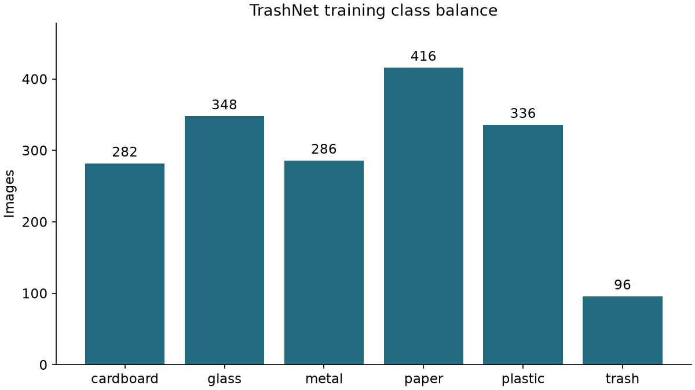
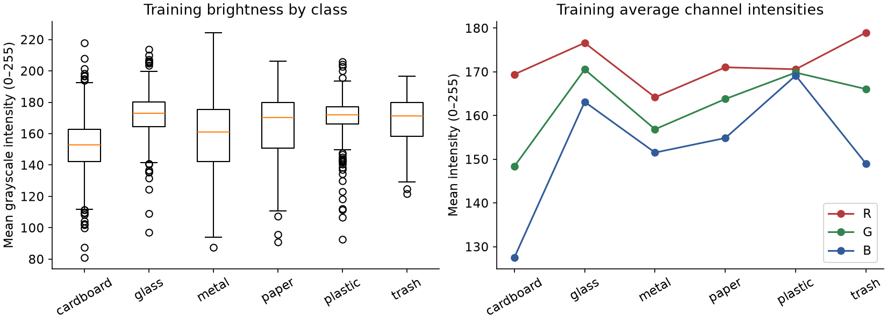

# TrashNet dataset audit and exploratory analysis

These results describe the pinned source archive and the committed manifest.
Only training images were used for visual samples and exploratory intensity statistics.
All-file checks before splitting were limited to integrity, labels, and duplicate review.

## Integrity and duplicate findings

Audited 2527 files: 2527 readable, 0 unreadable. Original class counts match upstream: True. Source color modes: RGB; resolutions: 512x384.

Excluded 6 images from 3 identical-content groups with conflicting labels. Neither member is assigned an assumed corrected label. The source files are unchanged.

| Excluded image | Conflicting content group |
| --- | --- |
| glass/glass115.jpg | glass/glass115.jpg |
| glass/glass176.jpg | glass/glass176.jpg |
| glass/glass389.jpg | glass/glass389.jpg |
| metal/metal91.jpg | glass/glass115.jpg |
| plastic/plastic152.jpg | glass/glass176.jpg |
| plastic/plastic332.jpg | glass/glass389.jpg |

Reviewed 45 perceptual-hash candidates at Hamming distance ≤ 6: 29 same-item pairs, 10 different-item pairs, and 6 uncertain pairs. Same-item and uncertain pairs stay within a partition. These decisions are Codex visual assessments; a teammate should review the uncertain cases before locking the modeling protocol.

## Split inventory

| Class | Train | Validation | Test |
| --- | ---: | ---: | ---: |
| cardboard | 282 | 61 | 60 |
| glass | 348 | 75 | 75 |
| metal | 286 | 62 | 61 |
| paper | 416 | 89 | 89 |
| plastic | 336 | 72 | 72 |
| trash | 96 | 21 | 20 |

## Training observations

The training partition contains 1764 images. The largest class is paper (416); the smallest is trash (96). The ratio is 4.33:1. Use macro F1 and per-class recall, and compare class weighting during model development.

| Class | Median brightness | Mean red | Mean green | Mean blue |
| --- | ---: | ---: | ---: | ---: |
| cardboard | 153.0 | 169.4 | 148.4 | 127.5 |
| glass | 173.0 | 176.6 | 170.5 | 163.1 |
| metal | 161.2 | 164.2 | 156.9 | 151.5 |
| paper | 170.3 | 171.0 | 163.8 | 154.9 |
| plastic | 172.1 | 170.6 | 169.8 | 169.2 |
| trash | 171.4 | 179.0 | 166.0 | 149.0 |

Training resolutions: 512 × 384. Preserve aspect ratio when resizing.

The source was photographed on a white posterboard. Full-image color and brightness measurements mix object and background signals. Compare descriptor families and test background sensitivity later; these plots do not prove causation.

## Review and evaluation limits

Exact-content exclusions, candidate pairs, and review decisions are committed with the manifest. Uncertain pairs are grouped conservatively. The split code checks that groups, byte hashes, and decoded-content hashes do not cross partitions.

Perceptual hashing proposes candidates, not proof of identity. Same-item views with large viewpoint, rotation, or framing changes can remain undetected. A broader object-identity review would strengthen the evaluation. Complete item-level isolation is not established.

The local sample grid is in `artifacts/eda/training-samples.jpg`. Source-image review sheets are local in `artifacts/duplicate-review/`. Neither is uploaded to Git.

No models have been trained or test prediction scores examined at this milestone.
