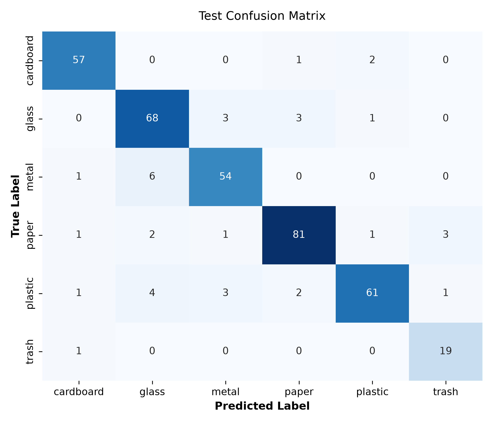
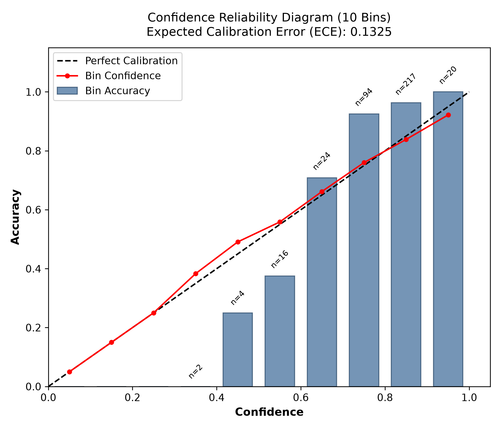

# Model Calibration, Validation Abstention, and Test Evaluation

This document records the frozen calibration, threshold selection, and final test
evaluation of the Phase 1 Smart Waste Segregation model.

## 1. Frozen Model and Calibration Protocol

- **Selected Model**: Extended RBF SVM (`global_color_spatial_texture`)
- **Feature Extraction**: 2,760 extended descriptors; 1,608 internally selected
- **Normalization**: Elementwise square root then per-image L2 (`root_l2`)
- **SVM Hyperparameters**: `C=10.0`, `gamma=10.0`, `class_weight=None`, `seed=42`
- **Calibration Method**: Sigmoid calibration via `CalibratedClassifierCV(ensemble=True)`
- **Calibration Folds**: 5 explicit frozen folds from `docs/training/folds.json`
- **Training Complement Isolation**: Each base pipeline is trained strictly on 4/5 of outer training data; each calibrator is fitted on the withheld 1/5. No model is calibrated on data it trained on.
- **Limitation Note**: Chosen hyperparameters were previously selected using these training folds; calibration diagnostics on those rows are not independent performance estimates.

## 2. Validation Abstention Selection

- **Validation Split**: 380 images
- **Threshold Grid**: 0.00 through 1.00 (step 0.01)
- **Selected Threshold**: **0.52**
- **Validation Coverage**: **0.9816** (373/380)
- **Validation Accepted Accuracy**: **0.9008**
- **Target Met**: `True` (Target: accuracy ≥90%, coverage ≥80%)
- **Selection Rule**: highest coverage with accuracy >= target and coverage >= min_coverage; ties to lower threshold

> [!NOTE]
> Abstention does not establish reliable detection of unknown object categories.

## 3. Untouched Test Set Evaluation

- **Test Split**: 377 images

### Unconditional Performance (Before Abstention)

- **Macro F1**: **0.8999**
- **Accuracy**: **0.9019** (340/377)
- **Multiclass Log Loss**: **0.4599**
  - Formula: `- (1 / N) * sum_{i=1}^N sum_{c=1}^C y_{ic} * ln(p_{ic})`
- **Multiclass Brier Score**: **0.1828**
  - Formula: `(1 / N) * sum_{i=1}^N sum_{c=1}^C (p_{ic} - y_{ic})^2`
- **Expected Calibration Error (ECE)**: **0.1325** (10 fixed bins)
  - Formula: `sum_{m=1}^{10} (|B_m| / N) * |acc(B_m) - conf(B_m)|`

### Per-Class Test Metrics

| Class | Precision | Recall | F1-Score | Support |
| :--- | :---: | :---: | :---: | :---: |
| `cardboard` | 0.9344 | 0.9500 | 0.9421 | 60 |
| `glass` | 0.8500 | 0.9067 | 0.8774 | 75 |
| `metal` | 0.8852 | 0.8852 | 0.8852 | 61 |
| `paper` | 0.9310 | 0.9101 | 0.9205 | 89 |
| `plastic` | 0.9385 | 0.8472 | 0.8905 | 72 |
| `trash` | 0.8261 | 0.9500 | 0.8837 | 20 |

### Confusion Matrix

| True \ Pred | `cardboard` | `glass` | `metal` | `paper` | `plastic` | `trash` |
| :--- | :---: | :---: | :---: | :---: | :---: | :---: |
| `cardboard` | 57 | 0 | 0 | 1 | 2 | 0 |
| `glass` | 0 | 68 | 3 | 3 | 1 | 0 |
| `metal` | 1 | 6 | 54 | 0 | 0 | 0 |
| `paper` | 1 | 2 | 1 | 81 | 1 | 3 |
| `plastic` | 1 | 4 | 3 | 2 | 61 | 1 |
| `trash` | 1 | 0 | 0 | 0 | 0 | 19 |

### Selective Performance (After Abstention at Frozen Threshold)

- **Threshold**: `0.52`
- **Accepted Examples**: 371 / 377
- **Abstained Examples**: 6 / 377
- **Coverage**: **0.9841** (98.4%)
- **Accepted Accuracy**: **0.9137** (91.4%, +1.19 percentage points over unconditional)
- **Accepted Macro F1**: **0.9129**

## 4. Visualizations





## 5. Artifacts and Reproduction

Reproduction command:
```sh
python -m waste_sorting.evaluation --output docs/evaluation --artifacts artifacts/calibrated_svm
```

## 6. Provenance and Artifact Integrity

- **Original Evaluation Fingerprint (`calibration-protocol.json`)**: `26e7e076578c4646b63052a82f79f06916f2d0acb3eecf1c3a93c65da9de5e24`
- **Committed Package Source Hash (`b775f02`)**: `cab3b67772c89686c874670f9f4421e3d780af0963eda865bd8a2790d6dab35c`
- **Status & Author's Account**: Evaluation was performed on an uncommitted working tree (`working_tree_dirty: true`), and the exact historical source snapshot producing fingerprint `26e7e076...` was not captured as an independent git commit and cannot be independently reconstructed. Per the author's account, subsequent edits before commit `b775f02` were limited to line wrapping for `ruff check .` (E501) and reporting text clarifications. In strict accordance with the evaluation protocol, the model was not refitted and test evaluation was not rerun; the original evaluation fingerprint is preserved as historical ground truth. The original fingerprints and this qualification remain preserved in the evaluation records.

## 7. Model Artifact and Demo Handoff

- **Model Artifact Path**: `artifacts/calibrated_svm/model.joblib`
- **Model Checksum (SHA-256)**: `83b0658d5180c02d6f03dce835bb8e269d6a89a493b6298a2bb00fd594f3b112`
- **Model Size**: 66,270,283 bytes
- **Inference Entrypoint**: `from waste_sorting.prediction import predict_image`
- **Environment**: Python 3.12, pinned dependencies in `requirements.lock` (`scikit-learn==1.9.1`, `joblib==1.6.0`, `numpy==2.5.4`, `pillow==13.0.0`).
- **Handoff Documentation**: See the [project setup and demo instructions](../../README.md#running-the-photo-upload-demo) and [verified demo environment and artifact handoff](../demo-verification.md).

