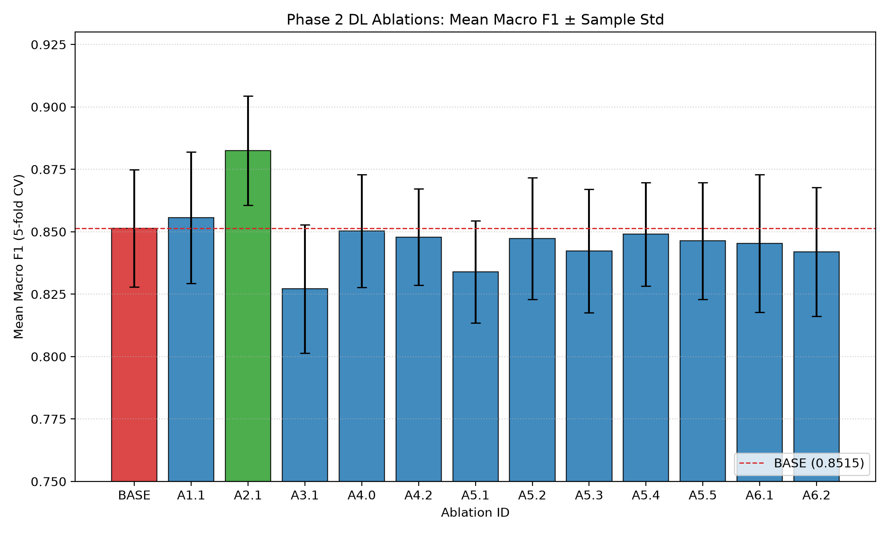

# Phase 2 Ablation Study: Results and Selection

**Author:** Aditya Bhardwaj  
**Reviewer:** Om Yadav  
**Specification:** Pre-registered one-factor-at-a-time (OFAT) ablation study ([`docs/phase-2/ablation-plan.md`](../ablation-plan.md)) evaluated strictly on the 5 frozen training cross-validation folds (`docs/training/folds.json`, 1,764 total training images).  
**Hardware & Platform:** All 13 configurations (65 individual fold runs) executed locally on Apple Silicon GPU (`mps`) with PyTorch 2.15.0.

---

## 1. Selected Configuration Box

> [!IMPORTANT]
> ### Selected CNN: `A2.1` (Partial Fine-Tuning: MobileNetV2, Last 2 Blocks)
> - **Configuration ID:** `A2.1`
> - **Mean 5-fold CV Macro F1:** **0.8825 ± 0.0219** (Gain over baseline: $\mathbf{+0.0310}$, exceeding $\sigma = 0.0235$)
> - **Mean Accuracy:** **89.80%**
> - **Trainable Parameters:** **893,766** (40.2% of backbone + 6-class linear head; remainder of backbone stays frozen)
> - **Exact `--set` Flags:** `--set dl.training.unfreeze_blocks=2`
> - **Median Best Epoch:** `13`
> - **Daksh's Late Fusion (H3) Out-of-Fold File:** [`docs/phase-2/ablations/selected-oof_predictions.csv`](selected-oof_predictions.csv) (1,764 rows)
> - **Prajjwal's Final Training Command:**
>   ```sh
>   waste-dl-train final --epochs 13 --output artifacts/phase2/final/A2.1 --set dl.training.unfreeze_blocks=2
>   ```

---

## 2. Comprehensive Ablation Results Table

All metrics represent the mean across the 5 frozen training folds (sample standard deviation $\sigma$ across folds). **Zero images from the validation or test splits were evaluated, fitted, or inspected.**

| Exp ID | Factor Tested | Configuration Description | Mean Macro F1 | Std F1 | Mean Accuracy | Median Best Epoch | Cardboard Recall | Glass Recall | Metal Recall | Paper Recall | Plastic Recall | Trash Recall | Mean Epochs | Mean Train Time (s) | Trainable Params |
| :--- | :--- | :--- | :---: | :---: | :---: | :---: | :---: | :---: | :---: | :---: | :---: | :---: | :---: | :---: | ---: |
| **BASE** | Baseline | MobileNetV2, Frozen, 224, Drop 0.2, Aug Full, None | 0.8515 | 0.0235 | 0.8719 | 38 | 0.9257 | 0.8936 | 0.8950 | 0.8967 | 0.8155 | 0.6563 | 39.8 | 178.1 | 7,686 |
| **A1.1** | Architecture | EfficientNet-B0, Frozen, 224, Drop 0.2, Aug Full, None | 0.8557 | 0.0263 | 0.8725 | 34 | 0.9080 | 0.9108 | 0.8846 | 0.8991 | 0.8184 | 0.6668 | 36.2 | 201.9 | 7,686 |
| **A2.1** | Fine-Tuning | MobileNetV2, Last 2 Blocks, 224, Drop 0.2, Aug Full, None | 0.8825 | 0.0219 | 0.8980 | 13 | 0.9433 | 0.8850 | 0.9439 | 0.9015 | 0.8601 | 0.7921 | 20.2 | 100.9 | 893,766 |
| **A3.1** | Resolution | MobileNetV2, Frozen, 160, Drop 0.2, Aug Full, None | 0.8271 | 0.0257 | 0.8470 | 29 | 0.9221 | 0.8419 | 0.8638 | 0.8654 | 0.8096 | 0.6458 | 36.4 | 118.6 | 7,686 |
| **A4.0** | Dropout | MobileNetV2, Frozen, 224, Drop 0.0, Aug Full, None | 0.8503 | 0.0226 | 0.8708 | 38 | 0.9257 | 0.8994 | 0.8845 | 0.8967 | 0.8125 | 0.6563 | 39.2 | 175.3 | 7,686 |
| **A4.2** | Dropout | MobileNetV2, Frozen, 224, Drop 0.5, Aug Full, None | 0.8479 | 0.0193 | 0.8691 | 40 | 0.9115 | 0.8850 | 0.9020 | 0.8991 | 0.8155 | 0.6458 | 40.0 | 175.7 | 7,686 |
| **A5.1** | Augmentation | No Augmentation (All Off) | 0.8339 | 0.0204 | 0.8600 | 40 | 0.9149 | 0.8591 | 0.8775 | 0.9087 | 0.8245 | 0.5621 | 40.0 | 168.5 | 7,686 |
| **A5.2** | Augmentation | No Random Resized Crop | 0.8472 | 0.0243 | 0.8702 | 39 | 0.9185 | 0.8965 | 0.8880 | 0.9015 | 0.8155 | 0.6353 | 39.8 | 172.8 | 7,686 |
| **A5.3** | Augmentation | No Horizontal Flip | 0.8422 | 0.0248 | 0.8651 | 37 | 0.9150 | 0.8908 | 0.8915 | 0.8919 | 0.8125 | 0.6142 | 39.6 | 174.6 | 7,686 |
| **A5.4** | Augmentation | No Random Rotation | 0.8490 | 0.0208 | 0.8725 | 39 | 0.9256 | 0.8821 | 0.8949 | 0.9111 | 0.8274 | 0.6032 | 39.8 | 169.2 | 7,686 |
| **A5.5** | Augmentation | No Color Jitter | 0.8463 | 0.0234 | 0.8680 | 38 | 0.9257 | 0.8879 | 0.8915 | 0.8943 | 0.8125 | 0.6353 | 39.8 | 168.8 | 7,686 |
| **A6.1** | Imbalance | Class-Weighted Cross-Entropy | 0.8453 | 0.0275 | 0.8662 | 38 | 0.9257 | 0.8850 | 0.8811 | 0.8774 | 0.8096 | 0.7289 | 39.8 | 176.7 | 7,686 |
| **A6.2** | Imbalance | Balanced Random Sampling | 0.8419 | 0.0258 | 0.8640 | 35 | 0.9187 | 0.8908 | 0.8810 | 0.8798 | 0.7946 | 0.7284 | 39.0 | 174.3 | 7,686 |



---

## 3. Analysis of Ablation Factors

### Factor 1: Backbone Architecture (`mobilenet_v2` vs. `efficientnet_b0`)
- **What Changed:** Swapping the frozen MobileNetV2 backbone for EfficientNet-B0 with SE attention and compound scaling.
- **Result:** Macro F1 changed from $0.8515 \pm 0.0235$ to $0.8557 \pm 0.0263$ ($\Delta = +0.0042$).
- **Verdict:** The $+0.0042$ difference is well within the fold-to-fold sample standard deviation ($\sigma = 0.0235$). Switching the frozen backbone alone provides **no clear difference under the pre-registered rule**, confirming that both ImageNet-pretrained extractors yield very similar frozen representations for TrashNet.

### Factor 2: Fine-Tuning Strategy (Frozen vs. Last 2 Blocks)
- **What Changed:** In `A2.1`, only the last 2 structural blocks of MobileNetV2 (indices 17 and 18, consisting of the final InvertedResidual block and $1 \times 1$ conv) were unfrozen at learning rate $10^{-4}$, while the remainder of the backbone (features 0 through 16) stays strictly frozen. This introduces **893,766 trainable parameters** (vs. 7,686 for the frozen head alone).
- **Result:** Macro F1 jumped from $0.8515 \pm 0.0235$ to $\mathbf{0.8825 \pm 0.0219}$ ($\Delta = \mathbf{+0.0310}$, accuracy $89.80\%$).
- **Verdict:** Because the gain of $\mathbf{+0.0310}$ **exceeds the cross-fold standard deviation ($\sigma = 0.0235$)**, `A2.1` represents a **clear improvement under the rule** over BASE. Crucially, adapting these top filters boosted recall on the underrepresented and visually variable classes: mean per-fold **trash recall rose from 65.63% to 79.21%** (+13.58% absolute gain) and **metal recall rose from 89.50% to 94.39%**. Moreover, convergence was substantially faster, reaching best validation loss in a median of 13 epochs (vs. 38 for BASE).

### Factor 3: Input Resolution ($224 \times 224$ vs. $160 \times 160$)
- **What Changed:** Reducing image resolution to $160 \times 160$ to simulate high-throughput, low-power edge deployment.
- **Result:** Macro F1 dropped from $0.8515 \pm 0.0235$ to $0.8271 \pm 0.0257$ ($\Delta = -0.0244$).
- **Verdict:** The $-0.0244$ degradation is **just beyond $\sigma = 0.0235$ (worse)**. While training speed was $\approx 33\%$ faster (118.6s vs. 178.1s per fold), preserving $224 \times 224$ resolution is critical for resolving fine visual textures (such as crinkled clear plastic vs. glass bottles).

### Factor 4: Head Regularisation (Dropout: 0.0 / 0.2 / 0.5)
- **What Changed:** Varying classification head dropout prior to the final linear layer.
- **Result:** $p=0.0$ (`A4.0`): $0.8503 \pm 0.0226$ ($\Delta = -0.0012$); $p=0.5$ (`A4.2`): $0.8479 \pm 0.0193$ ($\Delta = -0.0036$).
- **Verdict:** Both deviations from the baseline $p=0.2$ ($0.8515$) are negligible ($|\Delta| \le 0.0036 \ll \sigma = 0.0235$). For a frozen feature extractor with only a single linear layer, dropout rate in the range $[0.0, 0.5]$ makes **no clear difference under the pre-registered rule**.

### Factor 5: Data Augmentation Components
- **What Changed:** Disabling data augmentation altogether (`A5.1`), and disabling each individual augmentation step (`A5.2` to `A5.5`). Rotation in baseline is $\pm 10^\circ$ (`configs/phase2.toml`: `rotation_degrees = 10`), random crop scale is $0.8-1.0$, horizontal flip is $p=0.5$, and color jitter is $0.15/0.15/0.10$.
- **Result:**
  - Removing all augmentation (`A5.1`): F1 fell to $0.8339 \pm 0.0204$ ($\Delta = -0.0176$). Mean per-fold trash recall fell from $65.63\%$ to $56.21\%$.
  - Removing horizontal flip (`A5.3`): F1 dropped to $0.8422 \pm 0.0248$ ($\Delta = -0.0093$).
  - Removing color jitter (`A5.5`): F1 dropped to $0.8463 \pm 0.0234$ ($\Delta = -0.0052$).
  - Removing random crop (`A5.2`): F1 dropped to $0.8472 \pm 0.0243$ ($\Delta = -0.0043$).
  - Removing rotation of $\pm 10^\circ$ (`A5.4`): F1 reached $0.8490 \pm 0.0208$ ($\Delta = -0.0025$).
- **Verdict:** Under the pre-registered decision rule, removing all augmentation (`A5.1`, $\Delta = -0.0176$) remains within the fold standard deviation ($\sigma = 0.0235$), so it shows **no clear difference under the pre-registered rule**. All individual removal variants (`A5.2`--`A5.5`) also fall well within $\sigma$ (no clear difference under the pre-registered rule).

### Factor 6: Class Imbalance Handling
- **What Changed:** Applying class-weighted cross-entropy loss (`A6.1`) or balanced random sampling (`A6.2`).
- **Result:**
  - `A6.1` (Class-Weighted Loss): Macro F1 was $0.8453 \pm 0.0275$ ($\Delta = -0.0062$).
  - `A6.2` (Balanced Sampling): Macro F1 was $0.8419 \pm 0.0258$ ($\Delta = -0.0096$).
- **Verdict:** Overall macro F1 differences are within $\sigma = 0.0235$ (**no clear difference under the pre-registered rule** in overall Macro F1). However, inspecting minority class performance specifically:
  - **Mean per-fold trash recall:** BASE achieved $65.63 \pm 7.90\%$; `A6.1` achieved $72.89 \pm 11.46\%$; `A6.2` achieved $72.84 \pm 10.30\%$.
  - **Pooled out-of-fold trash recall:** BASE correctly classified $63/96$ ($65.62\%$), whereas `A6.1` and `A6.2` each correctly classified $70/96$ ($72.92\%$).
  Both imbalance strategies yielded a consistent $+7.26\%$ to $+7.30\%$ recall gain on trash, with slight tradeoffs on majority classes (cardboard and paper).

### Limitations & Budget Analysis
As documented in `docs/phase-2/ablations/summary.csv`, most frozen backbone configurations reached their best epoch at 38--40 of the 40-epoch cap (e.g., BASE median best 38, A4.2 and A5.1 median best 40), meaning they were still improving when the pre-registered 40-epoch cap stopped them. In contrast, `A2.1` converged early and stopped by itself via patience early stopping (median best epoch 13, mean 20.2 epochs run). Part of `A2.1`'s observed advantage may therefore stem from the fixed epoch budget constraining the slower-converging frozen models. Because the 40-epoch cap was pre-registered, the selection of `A2.1` stands as planned; evaluating frozen backbones under a longer epoch budget is identified as future work rather than evaluated post-hoc.

---

## 4. Cross-Paradigm Comparison: Best CNN vs. Phase 1 SVM vs. Hybrids

All models were evaluated using the identical 5 group-aware cross-validation folds (`docs/training/folds.json`) over the 1,764 training samples:

| Model Paradigm | Best Representative Architecture / Candidate | 5-Fold CV Macro F1 | 5-Fold CV Accuracy | Key Strengths / Trade-offs |
| :--- | :--- | :---: | :---: | :--- |
| **Phase 1 Classical ML** | RBF SVM on Handcrafted Extended Features (1,608 HSV/HOG/LBP cols) (`svm_rbf_color_hog_lbp`) | 0.8803 ± 0.0215 | 88.55% | Fast CPU inference, strong cardboard/paper separation; struggles on specular reflections (metal vs. glass). |
| **Phase 2 Frozen Single CNN** | MobileNetV2 Baseline (`BASE`) | 0.8515 ± 0.0235 | 87.19% | Zero backbone fine-tuning; underperforms Phase 1 SVM on minority classes (mean per-fold trash recall 65.63%). |
| **Phase 2 Fine-Tuned CNN** | MobileNetV2 Last 2 Blocks (`A2.1`) | **0.8825 ± 0.0219** | **89.80%** | **Best single CNN**. On par with Phase 1 SVM ($\Delta = +0.0022 \ll \sigma = 0.0215$), with higher accuracy (89.80% vs 88.55%) and balanced metal recall (94.39%). |
| **Phase 2 Hybrid H1** | Logistic Regression on EfficientNet-B0 Embeddings (`h1_efficientnet_b0_logreg_c1`) | 0.8597 ± 0.0194 | 87.58% | Classical classifier on frozen features; performs similarly to baseline frozen CNN head. |
| **Phase 2 Hybrid H2** | Early Feature Fusion: Handcrafted (1,608 cols) + EfficientNet-B0 Embeddings (1,280 cols) + RBF SVM | **0.9044 ± 0.0332** | **91.73%** | Leading hybrid in early fusion study. Gain over A2.1 ($\Delta = 0.0219 < \sigma = 0.0332$) shows no clear gain over the best single CNN under the threshold rule; final verdict comes from Daksh's PR B. |

---

## 5. Viva Notes: Key Questions & Model Answers

1. **Q: Why use a One-Factor-At-A-Time (OFAT) ablation design instead of a full combinatorial grid search?**  
   *A:* With 6 distinct design dimensions (backbone, fine-tuning depth, resolution, regularisation, 4 augmentation components, imbalance mitigation), a full grid search would require $2 \times 2 \times 2 \times 3 \times 16 \times 3 = 1,152$ configurations across 5 folds (5,760 training runs). OFAT isolates the causal impact of each architectural and regularisation decision independently with 13 controlled runs (65 folds), adhering to strict scientific pre-registration without exponential compute waste.

2. **Q: Why was configuration selection conducted exclusively on the 5 training CV folds rather than the validation or test splits?**  
   *A:* To enforce strict data isolation and prevent adaptive overfitting / information leakage. The validation split is reserved for downstream post-hoc calibration (temperature scaling) and selective abstention threshold sweeps. The test split is held out for the final frozen evaluation. Using training CV folds for model selection guarantees unbiased generalization estimates.

3. **Q: What did the ablation study reveal about frozen feature extraction versus partial fine-tuning?**  
   *A:* Frozen MobileNetV2 achieved 0.8515 Macro F1, falling short of the Phase 1 handcrafted SVM (0.8803). Fine-tuning only the last two blocks (`A2.1`, unfreezing 886,080 backbone parameters + 7,686 head parameters, leaving the first 17 blocks frozen) boosted performance to 0.8825 Macro F1 (+0.0310 gain, exceeding fold $\sigma = 0.0235$), demonstrating that adapting high-level convolutional filters to waste-specific materials (specular plastic, crumpled metal) is essential for domain transfer.

4. **Q: Why did unfreezing only the last 2 blocks work so well compared to training from scratch or full fine-tuning?**  
   *A:* With only 1,764 training samples, training all 2.2M backbone parameters from scratch risks severe overfitting. Keeping the first 17 blocks frozen preserved general ImageNet low/mid-level feature extractors (edges, textures, shapes), while adapting only the top InvertedResidual block and $1 \times 1$ expansion layer specialized representations for waste classes.

5. **Q: What was the observed effect of data augmentation?**  
   *A:* Disabling all augmentation (`A5.1`) caused Macro F1 to drop by $-0.0176$ (from 0.8515 to 0.8339), which remains within the fold std threshold ($\sigma = 0.0235$), showing no clear difference under the pre-registered rule. However, mean per-fold trash recall fell from 65.63% to 56.21%. Among individual components, removing $\pm 10^\circ$ rotation, crop, flip, or jitter individually also showed no clear difference under the pre-registered rule ($|\Delta| < \sigma$).

6. **Q: Did class-weighting or balanced sampling improve overall performance?**  
   *A:* Neither improved mean Macro F1 overall (0.8453 for class-weighted loss, 0.8419 for balanced sampling vs. 0.8515 baseline; both within $\sigma$). However, both imbalance mitigation strategies improved mean per-fold trash recall from 65.63% to ~72.9% (and pooled out-of-fold trash recall from 63/96 to 70/96), at the expense of modest recall reductions on majority classes (cardboard and paper).

7. **Q: Why was it essential that all 13 ablation runs were executed on the exact same hardware accelerator (MPS)?**  
   *A:* Cross-platform variations (e.g. differences between CUDA and MPS atomic operations, floating-point reduction order, and non-deterministic kernel implementations) introduce confounding numerical variance. Running all 65 folds on the exact same device ensures that all observed performance differences stem strictly from the experimental factors tested.

8. **Q: How does the selected CNN compare against Daksh's hybrid models?**  
   *A:* The selected partially fine-tuned CNN (`A2.1`, 0.8825 Macro F1) is on par with the Phase 1 SVM on handcrafted features (0.8803). Daksh's H2 hybrid model (early fusion of handcrafted features and EfficientNet-B0 embeddings with an RBF SVM) reaches 0.9044 Macro F1; the difference ($\Delta = 0.0219$) is less than H2's fold std ($\sigma = 0.0332$), indicating no clear gain over the best single CNN under the threshold rule, with the final verdict deferred to Daksh's PR B. Late fusion (H3) is not done yet.

