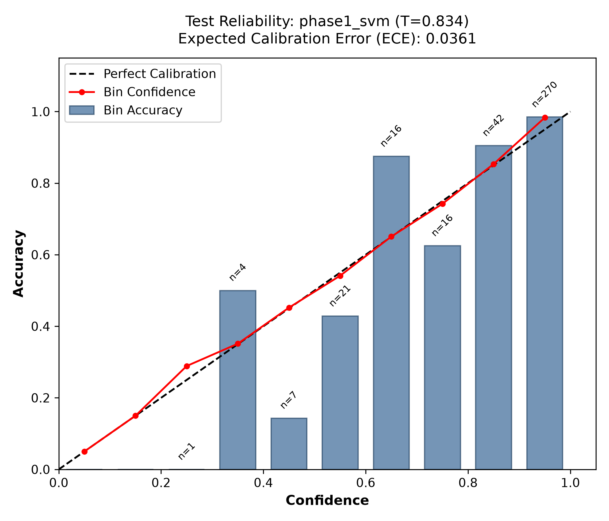
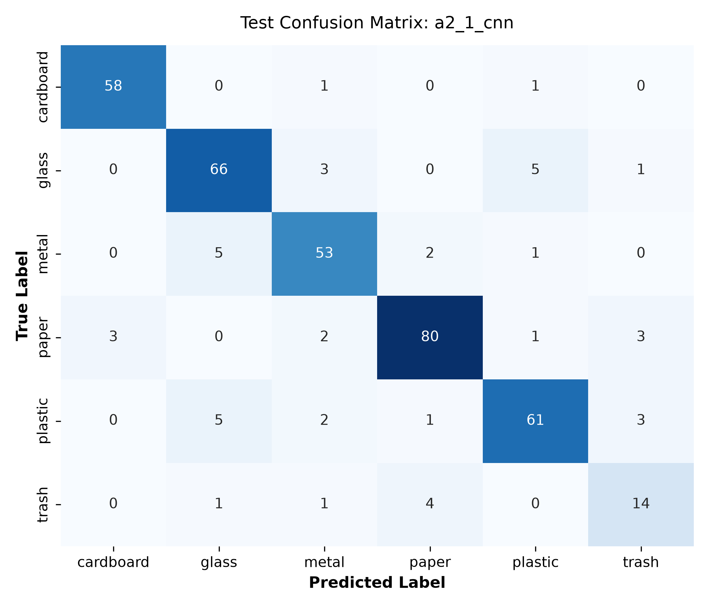
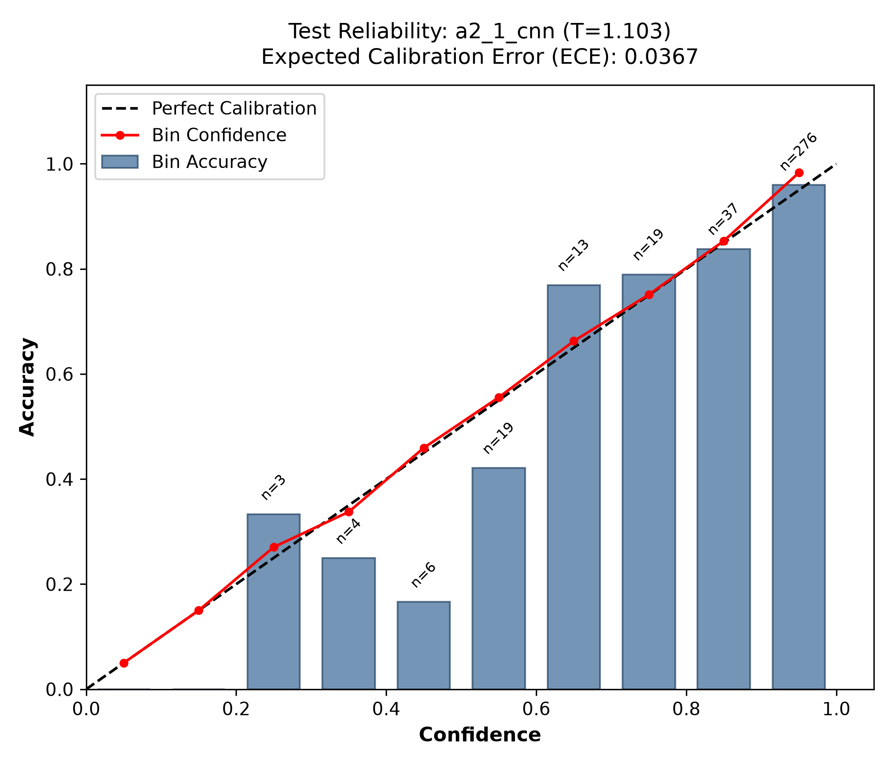
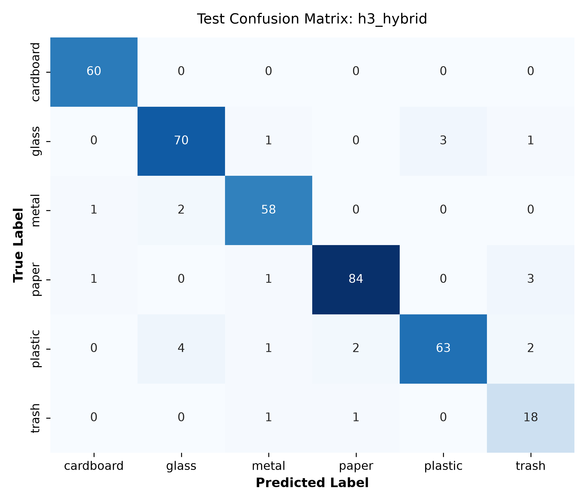
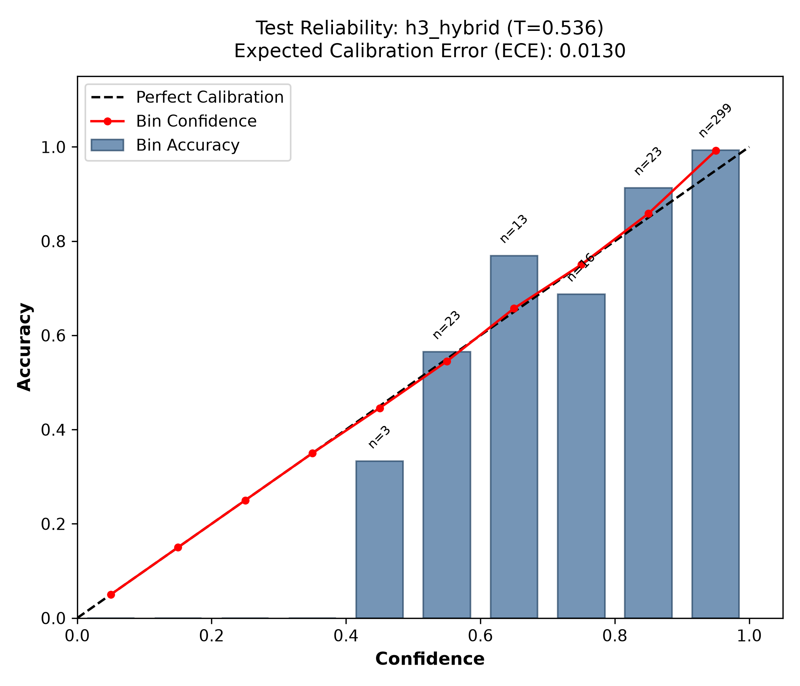
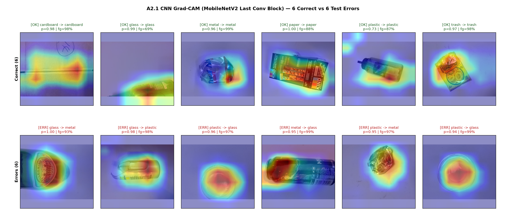

# Phase 2 Final Evaluation: Calibration, Frozen Protocol, and Single Test Run

All test numbers, confidence intervals, significance tests, confusion matrices, and failure counts in this document are generated strictly from the saved files [protocol.json](protocol.json), [test-predictions.csv](test-predictions.csv), and [test-metrics.json](test-metrics.json) without modifying the frozen protocol or rerunning test inference.

## 1. Frozen Protocol Summary

- **Git Revision at Freeze**: `62db0847aed82b6a2622bb5a19a903f21f677fa6`
- **Dataset Splits**: Training OOF (`1764` images), Validation (`380` images), Untouched Test (`377` images)
- **Calibration Method**: `temperature_scaling_on_training_oof` using `softmax(log(clip(p, 1e-12)) / T)`
- **Headline Abstention Rule**: `target_accuracy >= 0.90`, `min_coverage >= 0.80`
- **Demo Abstention Rule**: `target_accuracy >= 0.95`, `min_coverage >= 0.80`
- **Pre-Freeze Note**: demo_threshold added before the freeze because H3's headline threshold is 0.00 (no abstention); both are reported on test
- **Robustness Check**: `robustness set not available`

### Calibration Temperatures and Frozen Validation Thresholds

| Model | Frozen T | OOF ECE (Before -> After) | OOF LogLoss (Before -> After) | Headline Threshold (Val Cov / Val Acc) | Demo Threshold (Val Cov / Val Acc) |
| :--- | :---: | :---: | :---: | :---: | :---: |
| Phase 1 SVM (`phase1_svm`) | 0.8341 | 0.0387 -> 0.0126 | 0.3392 -> 0.3308 | `0.45` (0.9789 / 0.9032) | `0.76` (0.8500 / 0.9505) |
| A2.1 CNN (`a2_1_cnn`) | 1.1030 | 0.0158 -> 0.0081 | 0.2957 -> 0.2937 | `0.50` (0.9737 / 0.9000) | `0.87` (0.8237 / 0.9553) |
| H3 Hybrid (`h3_hybrid`) | 0.5362 | 0.0950 -> 0.0191 | 0.2399 -> 0.1856 | `0.00` (1.0000 / 0.9316) | `0.53` (0.9632 / 0.9508) |

| Model | Primary Frozen SHA-256 Hashes |
| :--- | :--- |
| Phase 1 SVM | `svm_pipeline`: `ca5a5411db8fbbe7...` |
| A2.1 CNN | `model.pt`: `26592f8b5aee95ed...` |
| H3 Hybrid (`w=0.5`) | `svm_pipeline`: `ca5a5411db8fbbe7...`, `model.pt`: `26592f8b5aee95ed...` |

## 2. Main Test Results (Untouched Test Split, N = 377)

### Unconditional Performance and 95% Paired Bootstrap Confidence Intervals (2,000 resamples, seed=42)

| Model | Macro F1 (95% CI) | Accuracy (95% CI) | ECE | Brier | Log Loss | Val Macro F1 |
| :--- | :---: | :---: | :---: | :---: | :---: | :---: |
| Phase 1 SVM | **0.8963** [0.8604, 0.9259] | **0.9019** [0.8700, 0.9310] | 0.0361 | 0.1415 | 0.3188 | 0.8956 |
| A2.1 CNN | **0.8577** [0.8127, 0.8970] | **0.8806** [0.8462, 0.9125] | 0.0367 | 0.1789 | 0.3717 | 0.8627 |
| H3 Hybrid | **0.9233** [0.8885, 0.9520] | **0.9363** [0.9098, 0.9602] | 0.0130 | 0.0971 | 0.2257 | 0.9201 |

### Selective Performance on Test (Both Pre-Declared Frozen Thresholds)

| Model | Rule | Frozen Threshold | Accepted / Total | Coverage | Accepted Accuracy | Accepted Macro F1 |
| :--- | :--- | :---: | :---: | :---: | :---: | :---: |
| Phase 1 SVM | Headline (90% val target) | `0.45` | 368 / 377 | 0.9761 (97.61%) | 0.9158 (91.58%) | 0.9098 |
| Phase 1 SVM | Demo (95% val target) | `0.76` | 318 / 377 | 0.8435 (84.35%) | 0.9717 (97.17%) | 0.9681 |
| A2.1 CNN | Headline (90% val target) | `0.50` | 364 / 377 | 0.9655 (96.55%) | 0.9038 (90.38%) | 0.8843 |
| A2.1 CNN | Demo (95% val target) | `0.87` | 288 / 377 | 0.7639 (76.39%) | 0.9549 (95.49%) | 0.9427 |
| H3 Hybrid | Headline (90% val target) | `0.00` | 377 / 377 | 1.0000 (100.00%) | 0.9363 (93.63%) | 0.9233 |
| H3 Hybrid | Demo (95% val target) | `0.53` | 364 / 377 | 0.9655 (96.55%) | 0.9533 (95.33%) | 0.9462 |

### Final Verdict

- **Best Model on Test**: **H3 Hybrid (`w=0.5`)** ranks first across every unconditional metric—Macro F1 **0.9233** (vs. Phase 1 SVM **0.8963** and A2.1 CNN **0.8577**), accuracy **93.63%**, lowest ECE (**0.0130**), lowest Brier score (**0.0971**), and lowest log loss (**0.2257**). At its frozen `demo_threshold` (`0.53`), H3 also achieves **95.33%** accepted accuracy at **96.55%** coverage, outperforming both single models.
- **Statistical Support**: Under exact pairwise McNemar tests (Bonferroni threshold `0.05 / 3 = 0.0167`), H3 Hybrid is **statistically superior to A2.1 CNN** (`p = 0.000019`, 23 vs 2 discordant wins, survives Bonferroni). Against **Phase 1 SVM**, H3 Hybrid leads `23` vs `10` on discordant test images (nominal exact `p = 0.0351 < 0.05`), which is suggestive in H3's favor but **does not clear the strict Bonferroni threshold `0.0167`** on `N = 377` test images (with overlapping 95% bootstrap CIs: [0.8885, 0.9520] vs [0.8604, 0.9259]). Between the two single models, A2.1 CNN and Phase 1 SVM do not differ significantly (`p = 0.3581`).

## 3. Pairwise Exact McNemar Tests

Exact two-sided binomial test (`scipy.stats.binomtest`) on unconditional prediction correctness (`Bonferroni alpha = 0.05 / 3 = 0.0167`):

| Comparison (A vs B) | Both Correct | A Only Correct | B Only Correct | Both Wrong | Discordant | Exact p-value | Sig (alpha=0.05) | Sig (Bonferroni 0.0167) |
| :--- | :---: | :---: | :---: | :---: | :---: | :---: | :---: | :---: |
| H3 Hybrid vs A2.1 CNN | 330 | 23 | 2 | 22 | 25 | 0.000019 | True | True |
| H3 Hybrid vs Phase 1 SVM | 330 | 23 | 10 | 14 | 33 | 0.035082 | True | False |
| A2.1 CNN vs Phase 1 SVM | 307 | 25 | 33 | 12 | 58 | 0.358143 | False | False |

## 4. Phase 1 Reference Comparison

| Evaluator | Model Implementation | Calibration | Test Macro F1 | Test Acc | Test ECE | Test Brier | Test Log Loss | Headline Threshold (Cov / Acc) |
| :--- | :--- | :--- | :---: | :---: | :---: | :---: | :---: | :---: |
| Phase 1 (`docs/evaluation`) | 5-fold `CalibratedClassifierCV(ensemble=True)` | Internal Platt sigmoid | 0.8999 | 0.9019 | 0.1325 | 0.1828 | 0.4599 | `0.52` (0.9841 / 0.9137) |
| Phase 2 (`phase1_svm`) | Single `SVC(probability=True)` on full train | Platt + OOF Temp (`T=0.8341`) | 0.8963 | 0.9019 | 0.0361 | 0.1415 | 0.3188 | `0.45` (0.9761 / 0.9158) |

Phase 2's `phase1_svm` achieves the exact same test accuracy (`0.9019`, 340/377) as Phase 1's recorded result, with a minor `-0.0036` difference in Macro F1 (`0.8963` vs `0.8999`) caused by replacing Phase 1's 5-fold `CalibratedClassifierCV(ensemble=True)` ensemble with a single `SVC(probability=True)` refitted on all 1,764 training images using SVC's internal Platt scaling (whose predicted borders shift slightly on low-support `trash`, n=20). Crucially, applying OOF temperature scaling (`T = 0.8341`) removes Phase 1's underconfidence in the top confidence bin, cutting test ECE from `0.1325` to `0.0361` and log loss from `0.4599` to `0.3188`.

## 5. Per-Class Test Metrics and Visualizations

### Phase 1 SVM (`phase1_svm`)

| Class | Precision | Recall | F1-Score | Support |
| :--- | :---: | :---: | :---: | :---: |
| `cardboard` | 0.9206 | 0.9667 | 0.9431 | 60 |
| `glass` | 0.8415 | 0.9200 | 0.8790 | 75 |
| `metal` | 0.9167 | 0.9016 | 0.9091 | 61 |
| `paper` | 0.9405 | 0.8876 | 0.9133 | 89 |
| `plastic` | 0.9524 | 0.8333 | 0.8889 | 72 |
| `trash` | 0.7600 | 0.9500 | 0.8444 | 20 |

| True \ Pred | `cardboard` | `glass` | `metal` | `paper` | `plastic` | `trash` |
| :--- | :---: | :---: | :---: | :---: | :---: | :---: |
| `cardboard` | 58 | 0 | 0 | 0 | 2 | 0 |
| `glass` | 0 | 69 | 2 | 3 | 1 | 0 |
| `metal` | 1 | 5 | 55 | 0 | 0 | 0 |
| `paper` | 1 | 3 | 1 | 79 | 0 | 5 |
| `plastic` | 2 | 5 | 2 | 2 | 60 | 1 |
| `trash` | 1 | 0 | 0 | 0 | 0 | 19 |

### A2.1 CNN (`a2_1_cnn`)

| Class | Precision | Recall | F1-Score | Support |
| :--- | :---: | :---: | :---: | :---: |
| `cardboard` | 0.9508 | 0.9667 | 0.9587 | 60 |
| `glass` | 0.8571 | 0.8800 | 0.8684 | 75 |
| `metal` | 0.8548 | 0.8689 | 0.8618 | 61 |
| `paper` | 0.9195 | 0.8989 | 0.9091 | 89 |
| `plastic` | 0.8841 | 0.8472 | 0.8652 | 72 |
| `trash` | 0.6667 | 0.7000 | 0.6829 | 20 |

| True \ Pred | `cardboard` | `glass` | `metal` | `paper` | `plastic` | `trash` |
| :--- | :---: | :---: | :---: | :---: | :---: | :---: |
| `cardboard` | 58 | 0 | 1 | 0 | 1 | 0 |
| `glass` | 0 | 66 | 3 | 0 | 5 | 1 |
| `metal` | 0 | 5 | 53 | 2 | 1 | 0 |
| `paper` | 3 | 0 | 2 | 80 | 1 | 3 |
| `plastic` | 0 | 5 | 2 | 1 | 61 | 3 |
| `trash` | 0 | 1 | 1 | 4 | 0 | 14 |

### H3 Hybrid (`h3_hybrid`)

| Class | Precision | Recall | F1-Score | Support |
| :--- | :---: | :---: | :---: | :---: |
| `cardboard` | 0.9677 | 1.0000 | 0.9836 | 60 |
| `glass` | 0.9211 | 0.9333 | 0.9272 | 75 |
| `metal` | 0.9355 | 0.9508 | 0.9431 | 61 |
| `paper` | 0.9655 | 0.9438 | 0.9545 | 89 |
| `plastic` | 0.9545 | 0.8750 | 0.9130 | 72 |
| `trash` | 0.7500 | 0.9000 | 0.8182 | 20 |

| True \ Pred | `cardboard` | `glass` | `metal` | `paper` | `plastic` | `trash` |
| :--- | :---: | :---: | :---: | :---: | :---: | :---: |
| `cardboard` | 60 | 0 | 0 | 0 | 0 | 0 |
| `glass` | 0 | 70 | 1 | 0 | 3 | 1 |
| `metal` | 1 | 2 | 58 | 0 | 0 | 0 |
| `paper` | 1 | 0 | 1 | 84 | 0 | 3 |
| `plastic` | 0 | 4 | 1 | 2 | 63 | 2 |
| `trash` | 0 | 0 | 1 | 1 | 0 | 18 |

## 6. Grad-CAM Interpretability Check (`a2_1_cnn`)

Visual inspection of the 12-image Grad-CAM grid (6 correct spanning all classes, 6 high-confidence test errors spanning glass/metal/plastic confusions) shows a mixed but informative qualitative result regarding convolutional attention on MobileNetV2's final block. "Foreground" is defined heuristically as pixels with HSV saturation > 0.12 or value < 0.92 (a colour heuristic, without ground-truth object masks). On the positive side, A2.1 CNN does not cheat on the empty white posterboard or letterbox padding: 11 of 12 inspected heatmaps concentrate 80% or more of their activation mass on the foreground object region (mean 93.6%, range 69%--99%), with only minor spill onto lower padding/background in `glass/glass10.jpg` (69.3% foreground activation, 72.8% foreground area) and a weak top-left corner spot in `plastic/plastic1.jpg` (86.9% foreground activation, 69.7% foreground area). However, attending to the object silhouette alone is not sufficient to resolve fine-grained material ambiguity: in all 6 inspected errors (`glass307` -> metal at p=1.00, `glass102` -> plastic at p=0.98, `plastic233` -> glass at p=0.96, `metal293` -> glass at p=0.95, `plastic467` -> metal at p=0.95, and `plastic398` -> glass at p=0.94), Grad-CAM centers tightly on the object body, cup rim, metallic label, or specular highlight (93%--99% foreground activation mass; 66%--75% foreground area). Because transparent cups, cylindrical bottles/cans, and reflective wrappers share overlapping geometry, shape cues alone fail on hard glass/metal/plastic pairs. Crucially, Grad-CAM does not explain why A2.1 CNN trails Phase 1 SVM on test Macro F1 (the two single models do not differ significantly, McNemar exact p=0.358), nor does it establish complementary spatial features that lift H3 Hybrid; H3's gain is demonstrated by McNemar discordant counts (23 vs 2 wins over A2.1, p=0.000019), not Grad-CAM. Note that the inspected grid is limited to 12 images.

| Image ID | Outcome | True -> Predicted | Calibrated p | Foreground Area Share | Foreground CAM Energy |
| :--- | :---: | :--- | :---: | :---: | :---: |
| `cardboard/cardboard1.jpg` | correct | `cardboard` -> `cardboard` | 0.9839 | 75.0% | 98.3% |
| `glass/glass10.jpg` | correct | `glass` -> `glass` | 0.9882 | 72.8% | 69.3% |
| `metal/metal103.jpg` | correct | `metal` -> `metal` | 0.9628 | 74.8% | 98.7% |
| `paper/paper106.jpg` | correct | `paper` -> `paper` | 0.9989 | 60.6% | 88.1% |
| `plastic/plastic1.jpg` | correct | `plastic` -> `plastic` | 0.7328 | 69.7% | 86.9% |
| `trash/trash109.jpg` | correct | `trash` -> `trash` | 0.9714 | 74.7% | 98.0% |
| `glass/glass307.jpg` | wrong | `glass` -> `metal` | 0.9975 | 66.1% | 93.0% |
| `glass/glass102.jpg` | wrong | `glass` -> `plastic` | 0.9803 | 74.2% | 97.7% |
| `plastic/plastic233.jpg` | wrong | `plastic` -> `glass` | 0.9612 | 75.0% | 97.1% |
| `metal/metal293.jpg` | wrong | `metal` -> `glass` | 0.9501 | 75.0% | 99.2% |
| `plastic/plastic467.jpg` | wrong | `plastic` -> `metal` | 0.9469 | 74.8% | 97.2% |
| `plastic/plastic398.jpg` | wrong | `plastic` -> `glass` | 0.9390 | 75.0% | 99.3% |

## 7. Failure Analysis (Derived from `test-predictions.csv`)

- **Error Reduction & Complementarity**: Phase 1 SVM makes **37/377** errors and A2.1 CNN makes **45/377** errors, while H3 Hybrid cuts total errors to **24/377** (-35.1% vs. SVM, -46.7% vs. CNN). SVM and CNN disagree in correctness on **58/377** images (`25` CNN-only right, `33` SVM-only right), and H3 Hybrid predicts **46/58 (79.3%)** of those disagreements correctly.
- **Glass / Metal / Plastic Triplet**: Within-triplet confusions drop from **15** (Phase 1 SVM) and **21** (A2.1 CNN) down to **11** in H3 Hybrid. H3 Hybrid also achieves **60/60 (100.0% recall)** on `cardboard`.
- **Residual H3 Errors**: Top H3 confusion pairs are `plastic->glass` (4), `glass->plastic` (3), `paper->trash` (3), `metal->glass` (2), `plastic->paper` (2), `plastic->trash` (2). Exactly **12/377** images are missed by *all three* models (including `glass/glass207.jpg` (`glass` -> `trash`), `glass/glass288.jpg` (`glass` -> `plastic`), `glass/glass380.jpg` (`glass` -> `plastic`), `metal/metal245.jpg` (`metal` -> `cardboard`), `metal/metal37.jpg` (`metal` -> `glass`), `paper/paper201.jpg` (`paper` -> `metal`)); because both SVM and CNN err together on these cases, late fusion cannot rescue them.
- **Abstention Behaviour**: Under `demo_threshold` (`0.53`), H3 Hybrid flags **13** low-confidence images and intercepts **7/24** errors, raising accepted accuracy to **95.33%** at **96.55%** coverage.

## 8. Robustness Check

- **Status**: `robustness set not available` (`docs/robustness/` is not present on `main`).

## 9. Limitations

1. **Small Test Sample Size (N = 377, `trash` n = 20)**: With only 33 discordant predictions between H3 Hybrid and Phase 1 SVM, `p = 0.0351` falls short of the Bonferroni threshold (`0.0167`), so H3's win over SVM is suggestive/directional rather than Bonferroni-confirmed on this test split.
2. **TrashNet White-Posterboard Domain**: TrashNet images were photographed against a uniform white posterboard. The robustness set was not collected (`docs/robustness/` is not present on `main`), leaving out-of-domain generalization to cluttered, low-light, or multi-object photos unverified.
3. **Cross-Validation Optimism**: All models reused the same 5 training folds during model selection, inflating CV estimates (`H3` CV `0.9364` vs test `0.9233`; `A2.1` CV `0.8825` vs test `0.8577`).
4. **Fold-OOF Temperatures Applied to Full-Train Models**: Temperatures were fitted on out-of-fold predictions of fold models, while the evaluated models are the final full-training-split models, as in Phase 1.
5. **Validation-to-Test Coverage Shift under Tight Thresholds**: Under `demo_threshold` (`0.87`), `a2_1_cnn` reached 76.4% test coverage (76.39%), falling below its 80% validation coverage (82.37%), showing that validation-chosen thresholds do not transfer exactly near strict accuracy targets when confidence margins shift across splits.
6. **H3 Fitted from Uncommitted Working Tree**: The final H3 hybrid was fitted from a working tree with uncommitted modifications (`working_tree_dirty: true` in metadata); component model and OOF SHA-256 hashes are pinned and verified in `protocol.json`.

## 10. Viva Notes (Q&A)

1. **Q: Why fit temperature scaling on training OOF instead of validation?**  
   **A:** Training OOF predictions come from fold models that never saw those images, giving 1764 unbiased calibration examples while keeping all 380 validation images untouched for independent abstention threshold selection (mirroring Phase 1).
2. **Q: Why freeze a second `demo_threshold` before seeing test data?**  
   **A:** H3's 90%-target `headline_threshold` was `0.00` (already >93% accurate on validation without abstaining), so a pre-declared 95%-target `demo_threshold` (`0.53`) was frozen before test access to exercise real selective abstention.
3. **Q: Why did Phase 1 SVM's Macro F1 shift slightly (`0.8963` vs `0.8999`)?**  
   **A:** Phase 2 evaluates Daksh's exported full-training-split `SVC(probability=True)` rather than Phase 1's 5-fold `CalibratedClassifierCV` ensemble; both classify 340/377 (90.19%) test images identically, while OOF `T=0.8341` cut ECE by 72.8%.
4. **Q: Is H3 Hybrid statistically significantly better than both baselines?**  
   **A:** Yes over A2.1 CNN (`p = 0.000019 < 0.0167`), and nominally over Phase 1 SVM (`p = 0.0351 < 0.05`) though short of strict 3-way Bonferroni (`0.0167`).
5. **Q: Why did A2.1 CNN underperform Phase 1 SVM on test (`0.8577` vs `0.8963`)?**  
   **A:** With only 1764 training images across 6 classes, handcrafted color and spatial texture histograms (`1,608` dims) capture material reflectance well; CNN features struggle alone on TrashNet's specular glass/metal/plastic overlaps.
6. **Q: Why does H3 Hybrid (`w=0.5`) work even though A2.1 CNN trails SVM?**  
   **A:** The two models have distinct inductive biases and disagree on 58/377 images (`p_both_wrong = 3.2%`), allowing calibrated probability averaging to correct errors of either individual model.
7. **Q: What did Grad-CAM tell us about Daksh's "CNN sees shape" hypothesis?**  
   **A:** Mixed: A2.1 CNN focuses overwhelmingly on the physical object rather than the posterboard, yet still fails at high confidence on glass/metal/plastic lookalikes because silhouette/shape overlaps across materials.
8. **Q: Can abstention reliably detect unknown or out-of-domain waste objects?**  
   **A:** No. Softmax confidence thresholding filters low-margin closed-set ambiguities on TrashNet, not out-of-distribution inputs.
9. **Q: Why was the test split touched only once and `protocol.json` committed first?**  
   **A:** Committing model SHA-256 hashes, temperatures, and thresholds before any test inference creates an auditable Git guarantee against post-hoc tuning.
