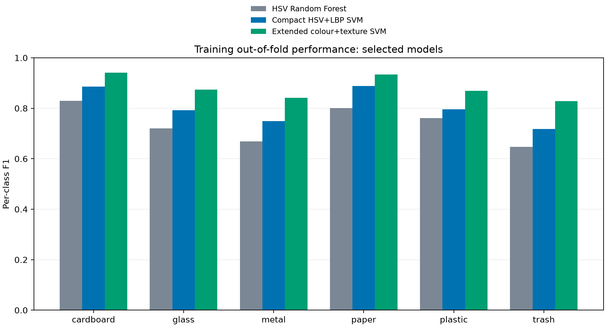
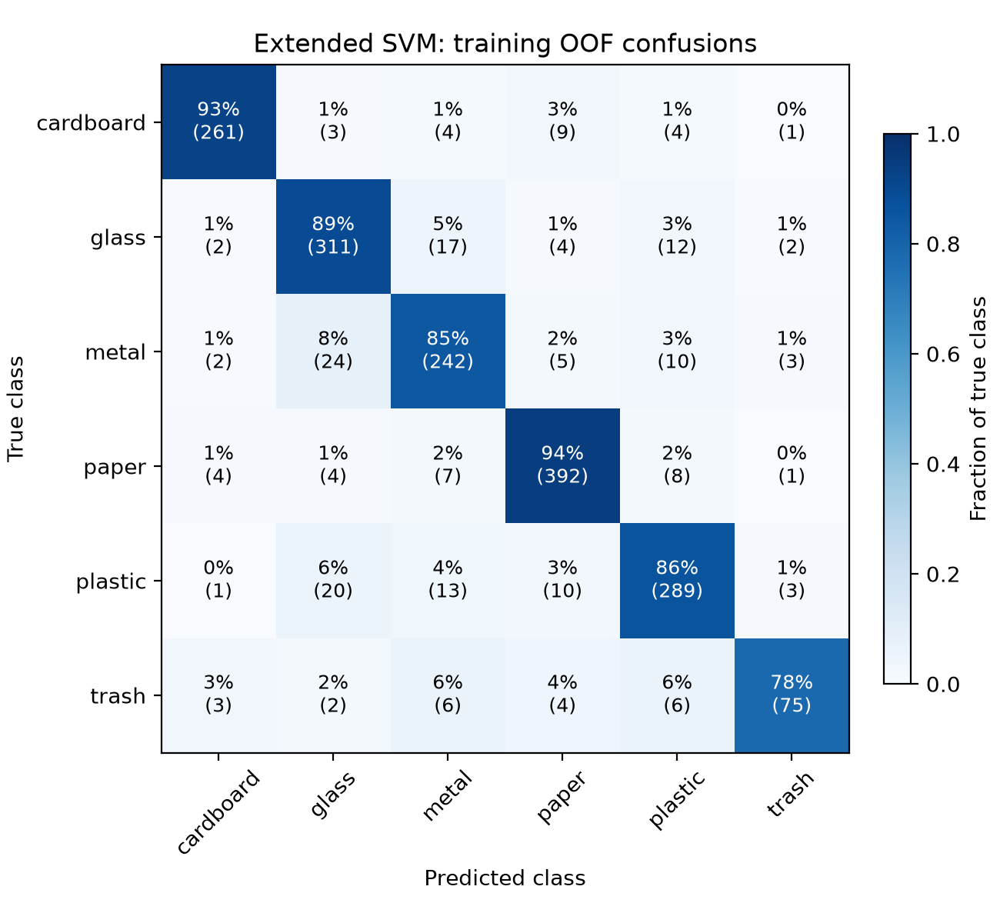

# Extended SVM results

All scores use the original training folds and were used for model selection. They are exploratory; outer validation/test performance is unknown.

| Model | Mean fold macro F1 | Pooled OOF accuracy |
| --- | ---: | ---: |
| HSV Random Forest | 0.7366 | 0.7540 |
| Compact HSV+LBP SVM | 0.8042 | 0.8197 |
| Extended colour+texture SVM | 0.8803 | 0.8900 |

Selected family: `global_color_spatial_texture`; 1608 selected columns from the full 2,760-dimensional input. Fold std: 0.0215.

Parameters: `{"classifier__C": 10.0, "classifier__class_weight": null, "classifier__gamma": 10.0}`.

See comparison.csv for all four families, candidate-results.csv for all 72 candidates, per-class.csv for the winner, and summary.json for full provenance.

[Protocol and reproduction](../extended-svm-study.md)
