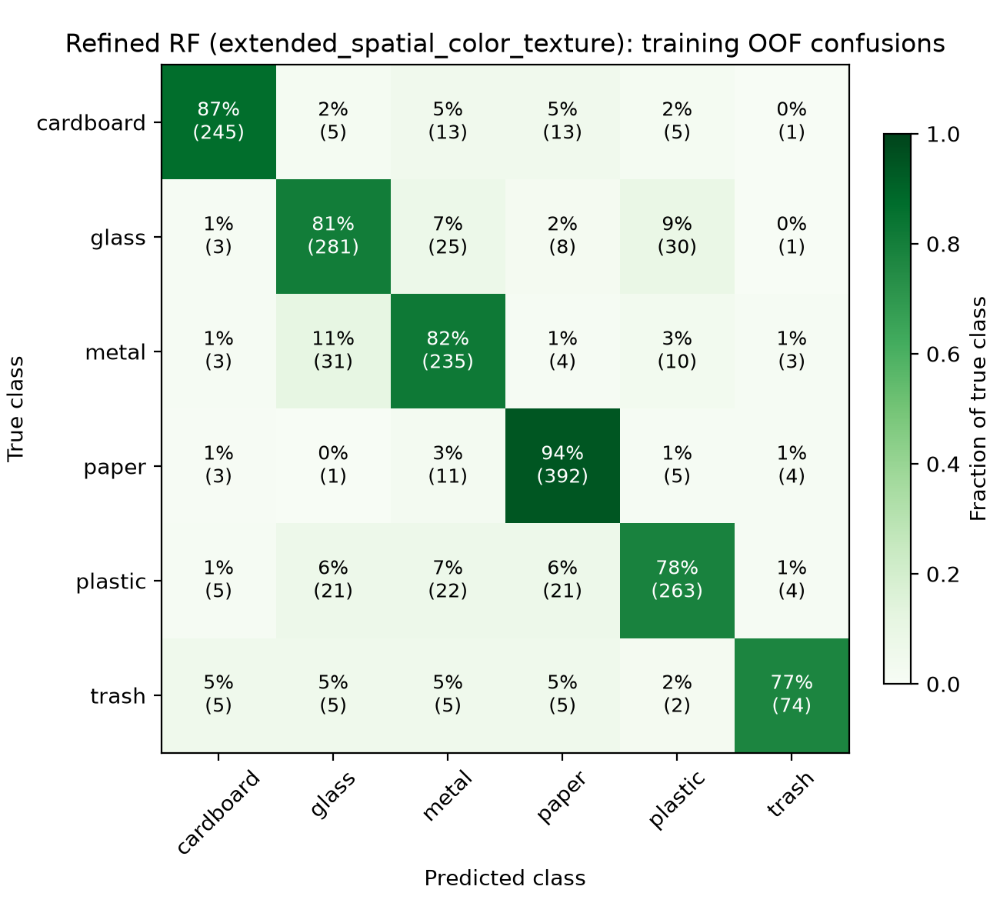
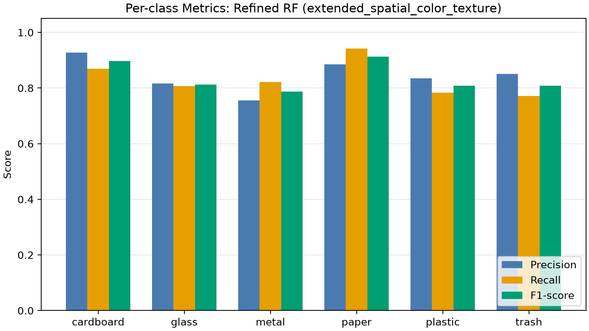

# Random Forest refinement: verified results

Generated from saved records; no experiment fitting. Do not hand-edit these tables.

## Feature families

| Family | Input dims | Selected dims | Mean CV macro F1 | Fold std | Pooled OOF accuracy | Family CV search wall time (s) | Best parameters |
| --- | --- | --- | --- | --- | --- | --- | --- |
| `original_hsv` | 1806 | 32 | 0.741915 | 0.017718 | Not recorded | 93.3 | `{"classifier__bootstrap": true, "classifier__class_weight": null, "classifier__max_depth": 20, "classifier__max_features": 0.25, "classifier__min_samples_leaf": 1, "classifier__min_samples_split": 2, "classifier__n_estimators": 300}` |
| `extended_global_color_texture` | 2760 | 920 | 0.831143 | 0.013520 | Not recorded | 1986.5 | `{"classifier__bootstrap": true, "classifier__class_weight": "balanced", "classifier__max_depth": null, "classifier__max_features": 0.25, "classifier__min_samples_leaf": 1, "classifier__min_samples_split": 2, "classifier__n_estimators": 600}` |
| `extended_global_color_spatial_texture` | 2760 | 1608 | 0.826281 | 0.015241 | Not recorded | 3825.5 | `{"classifier__bootstrap": true, "classifier__class_weight": "balanced", "classifier__max_depth": null, "classifier__max_features": 0.25, "classifier__min_samples_leaf": 1, "classifier__min_samples_split": 2, "classifier__n_estimators": 600}` |
| `extended_spatial_color_texture` | 2760 | 2760 | 0.836955 | 0.024141 | 0.844671 | 5471.6 | `{"classifier__bootstrap": true, "classifier__class_weight": "balanced", "classifier__max_depth": null, "classifier__max_features": "sqrt", "classifier__min_samples_leaf": 1, "classifier__min_samples_split": 2, "classifier__n_estimators": 600}` |

Family CV search wall time measures all 24 candidates × 5 folds (120 fits), including parallel scheduling, fitting, prediction and scoring. It excludes feature extraction, the final winning estimator refit, serialization and OOF diagnostics. Final-refit time was not recorded. The preserved raw `seconds` field has this meaning.

Only the overall winner has saved OOF diagnostics. Other family accuracies are not recorded.

## Cross-study comparison

| Model | Representation | Selected dims | Mean CV macro F1 | Fold std | Pooled OOF accuracy |
| --- | --- | --- | --- | --- | --- |
| Dummy baseline | HSV+HOG+LBP | 1806 | 0.063608 | 0.000195 | Not recorded |
| Original linear SVM | HSV+HOG+LBP | 1806 | 0.600692 | 0.028371 | Not recorded |
| Original RBF SVM | HSV+HOG+LBP | 1806 | 0.673063 | 0.033865 | Not recorded |
| Original HSV RF | HSV | 32 | 0.736622 | 0.025990 | 0.753968 |
| Compact RBF SVM | HSV+LBP | 42 | 0.804174 | 0.018910 | 0.819728 |
| Refined RF | Extended spatial color+texture | 2760 | 0.836955 | 0.024141 | 0.844671 |
| Extended RBF SVM | Extended global color+spatial texture | 1608 | 0.880263 | 0.021545 | 0.890023 |

- **Dummy baseline**: `Not recorded: no saved OOF predictions or diagnostic summary`.
- **Original linear SVM**: `Not recorded: no saved OOF predictions or diagnostic summary`.
- **Original RBF SVM**: `Not recorded: no saved OOF predictions or diagnostic summary`.
- **Original HSV RF**: `svm-study-results/summary.json → diagnostics.random_forest_color.accuracy`.
- **Compact RBF SVM**: `svm-study-results/summary.json → diagnostics.rbf_svm.accuracy`.
- **Refined RF**: `rf-refinement-results/training-oof-predictions.csv; summary.json → diagnostics.accuracy`.
- **Extended RBF SVM**: `extended-svm-results/summary.json → diagnostics.accuracy`.

Full-precision metrics and source paths are in `cross-study-comparison.csv`. `comparison.csv`, `candidate-results.csv` and `summary.json` preserve the raw experiment.

## Verification

All 96 candidates use the same 24 sampled configurations by index across four families. All 480 recorded fold scores reproduce their candidate means and population standard deviations (ddof=0; tolerance 1e-12; maximum error 9.71e-17). All family winners and the overall selection agree with the recorded tie-break rules.

Frozen fold SHA-256: `6525c05675d2c9470659f2ad6a5721cadbe8558ac977ef7ef06dc858488b6625`. Fold sizes: `[354, 354, 352, 352, 352]`. The 1,764 unique OOF rows match the training manifest, labels, duplicate groups and every frozen fold assignment; groups do not cross folds or outer splits.

Winner fold macro F1 reproduced from predictions: `[0.8336108303148674, 0.8466452726017942, 0.8622642553542916, 0.8500010472588052, 0.7922544828126225]`. Accuracy: **0.844671201814059** (1490 / 1,764); pooled macro F1: **0.8377107269285956**. Confusion counts and per-class metrics also agree.

Historical diagnostic accuracies were recomputed from integer confusion counts and checked against fold-size-weighted accuracies. The compact study's linear-SVM diagnostic belongs to its HSV+LBP model, not the original combined-feature linear baseline.

Recorded plan hash, shared runner folds, manifest identities/groups, and winner OOF assignments agree. Nonwinning candidate predictions/indices were not saved; their fold use is supported by the shared task construction, not a separate trace.

The completed experiment was not refitted. These are exploratory selection-CV scores, not untouched-test estimates. See `validation.json` for exact values and source hashes.

