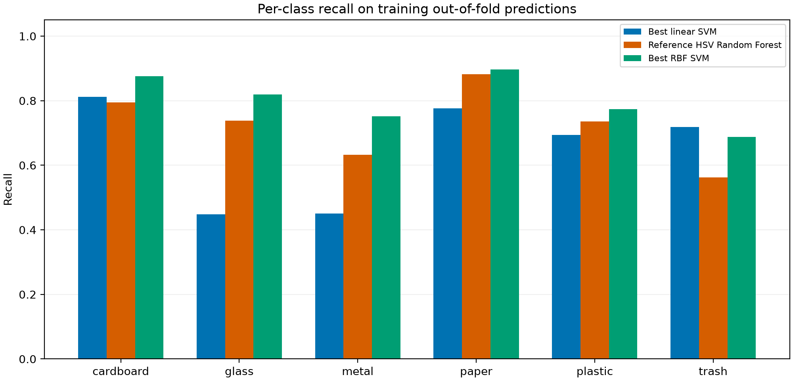
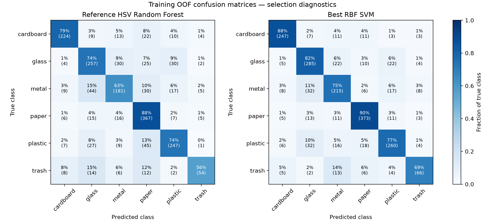

# Verified SVM follow-up results

All scores use the fixed outer-training folds. Parameters and feature families were selected using these scores; they are not final-test estimates.

| Model | Pooled OOF accuracy | Mean fold macro F1 | Pooled OOF macro F1 |
| --- | ---: | ---: | ---: |
| Best linear SVM | 0.6457 | 0.6203 | 0.6208 |
| Reference HSV Random Forest | 0.7540 | 0.7366 | 0.7378 |
| Best RBF SVM | 0.8197 | 0.8042 | 0.8048 |

See comparison.csv for all winning runs, candidate-results.csv for every candidate, per-class.csv for class metrics, and summary.json for full provenance.

Outer validation and test predictions were not generated.
